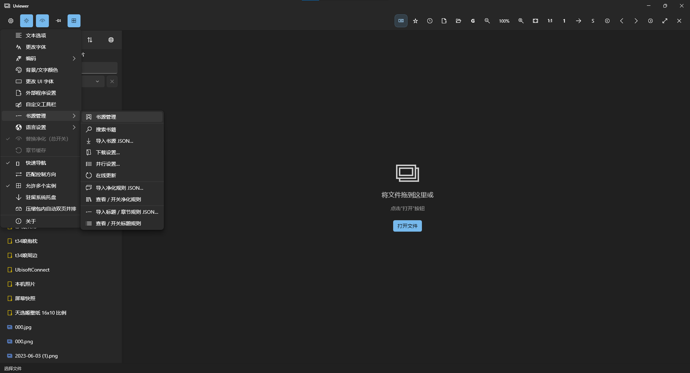
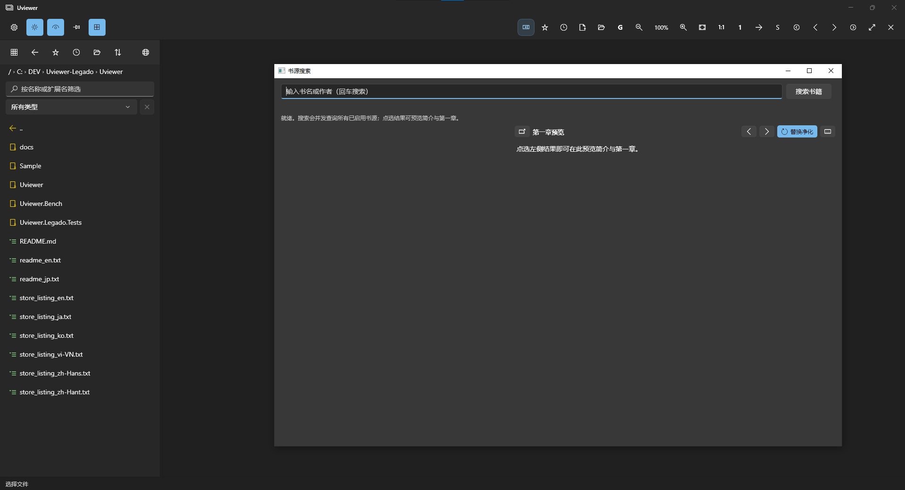

# Uviewer-Legado

> 在开源阅读看图工具 [Uviewer](https://github.com/kirinonakar/Uviewer) 的基础上，内置一套与 **Legado（阅读 App）同构的网络书源引擎**，让 Windows 桌面端也能"导入书源 → 搜书 → 在线阅读 → 整本下载"。






---

## 可用二进制请从Actions获取
**arm64和x86版本没有经过严格测试**

## ⛔ 支持边界：不处理音视频（重要）

**本项目始终不处理音频与视频内容。** 书源引擎只处理文本类书源（`bookSourceType = 0`）：

- 音频（`1`）/ 视频（`4`）书源**不实现播放、不接入 WebView 播放链路、不进入文本阅读与整本下载**；
- 多源搜索时这类结果**照常展示**（能搜到说明该源确有此书），但卡片会标注「不支持音视频」，
  下载按钮禁用，也不会为其拉取章节目录；
- 图片书源（`2`）不属于音视频，按正常文本链路处理。

这是本项目的**长期设计决策**，不是待办事项。

## ✨ 相对Fork源的修改

### 1. Legado 书源引擎（核心）

- **书源管理**：导入 / 导出 / 启停 / 编辑 legado 书源 JSON，徽标标注每个源的能力缺口；
- **多源搜索**：独立非模态窗口，逐源流式渲染结果；点选条目即插队优先加载，
  左侧下方展开**书籍简介**，右侧直接预览**第一章正文**；
- **在线阅读**：详情 → 目录 → 正文全链路，正文经「替换净化 + 标题规则」处理后交给原生分页画布排版；
- **整本下载**：章节并发下载、每源限速（`concurrentRate`）、失败章占位、零正文判失败。

### 2. 脚本与规则引擎

对 legado 书源里的 JavaScript 做了系统性实现：

### 3. WebView2 验证码窗口

书源把正文藏在图形验证码 / Cloudflare 后面时，弹出 WebView2 窗口：**你在页面里手动完成验证**，
点「完成」后页面 HTML 与全部 Cookie 自动回灌共享会话——后续抓取带着登录态继续，不会让解析直接失败
（WebView2 不可用时自动回退普通 HTTP）。

### 4. 下载文件标记 + 差分在线更新

- 下载结果**合并保存为单个 TXT**，文件头写入 `[Uviewer-Legado]` 标记块（**UUID** / 书源 URL / 书籍 URL），
  目录快照存同目录 `<文件名>.legado.json`；
- **打开带标记的 TXT 自动进入阅读模式并自动建立章节缓存**；
- **UUID 绑定缓存**：所有开启本地缓存的文件都写入 UUID，文件改名 / 移动后凭 UUID 重新关联缓存与进度；
- **在线更新**（书源管理二级菜单）：按原始链接拉最新目录做**差分更新**——只联网下载新增/变化章节，
  未变章节复用本地内容；远程目录**大规模修改时另存新文件**（不覆盖原文件）。

### 5. 阅读体验增强

- **阅读模式总开关**（顶栏 `A`）：排版（Win2D 分页画布）+ 替换净化 + 标题分章目录 + 章节缓存一起生效；
- **章节导航**：阅读模式下 ↑ / ↓ 与工具栏按钮变为**上一章 / 下一章**，支持连续按键逐章推进；
- **内置净化规则**：自动剔除「分卷阅读 + 数字」类噪音行（标题 / 正文双通道恒开，无需配置）；
- **「本章生效」标记**：替换净化规则管理中标记真正作用于当前章节的规则；
- **窗口化缓存**：统一「前 2 后 5 + 当前章 = 8 章」窗口，无缓存文件用内存窗口不落盘。

### 6. 并行与设置

- **并行设置**（书源管理二级菜单）：搜索并发（1–64）与下载并发（1–16）输入式调整，持久化保存；
- 多源搜索默认并发 32（打的是不同站点，不放大单站压力）；
- **搜索框取消按钮**：搜索中可随时取消，输入框立即恢复可编辑，换词即搜。

## 🔧 对原项目逻辑的修改

新增能力之外，对 Uviewer 原有逻辑做过的必要调整（均为最小侵入）：

- **文本打开流程**：接入「阅读模式自动判定」「缓存 UUID 回退查找」「下载标记识别」三个检查点；
- **顶栏上/下一个文件**：阅读模式下语义变为上一章/下一章（原文件导航在非阅读模式完全保留）；
- **工具栏「书源」菜单**：新增书源管理 / 搜索 / 下载设置 / 并行设置 / 在线更新二级项；
- **主题系统**：`LegadoTheme` 为新增 UI 提供亮暗成对语义色（Critical / Caution 等），不改动原版配色。

看图、PDF、EPUB、青空排版、WebDAV、托盘、快捷键等原有能力**行为不变**
（完整功能列表见[上游 README](https://github.com/kirinonakar/Uviewer)）。

## 📦 编译方法

### 环境要求

| 依赖        | 版本                                                                            |
| ----------- | ------------------------------------------------------------------------------- |
| Windows     | 10 19041+ / 11（WebView2 Runtime 建议安装，验证码窗口需要；Win11 一般自带）     |
| .NET SDK    | **10.0**（仓库 `global.json` 已钉 10.0.x，`dotnet --version` 不符会自动报错）   |
| 工作负载    | 随 SDK 自带（WinUI 3 / Windows App SDK 由 NuGet 还原，**无需安装 VS 工作负载**）|
| IDE（可选） | Visual Studio 2022+（含「通用 Windows 平台开发」相关组件）或直接用 `dotnet` CLI |

> 应用以 `WindowsAppSDKSelfContained` 方式编译，**运行设备无需安装 Windows App SDK 运行时**；
> 最低系统为 Win10 19041（2004），Win10/Win11 最新版本均可直接运行。

### 支持架构

| 架构  | 编译参数             | 说明                         |
| ----- | -------------------- | ---------------------------- |
| x64   | `-p:Platform=x64`    | **默认与主推架构**           |
| ARM64 | `-p:Platform=ARM64`  | Surface Pro X / 骁龙本等     |
| x86   | `-p:Platform=x86`    | 兼容 32 位环境               |

三种架构均已实测 0 错误编译，CI 矩阵（`.github/workflows/ci.yml`）对三架构逐一构建验证。
7-Zip 原生库（`7z.dll`，官方 26.05）按架构随包分发：源码位于 `Uviewer/Libs/{x64|x86|arm64}/`，
构建时自动复制为输出目录的 `Libs/7z.dll`，任意架构打开 `.7z` 压缩书均可用。

### 克隆与构建

> **路径口径（重要）**：本 README、CI（`.github/workflows/ci.yml`）及一切仓库内说明中的路径，
> 一律以 **git 仓库根目录**（即克隆后 `git clone` 得到的 `Uviewer-Legado/` 目录，而非它的某个
> 子目录或上层工作区）为基准。执行下列命令前请先 `cd Uviewer-Legado`。

```bash
git clone https://github.com/2333tech/Uviewer-Legado.git
cd Uviewer-Legado

# 编译（Debug x64；先关闭正在运行的 Uviewer.exe）
dotnet build Uviewer/Uviewer.csproj -c Debug -p:Platform=x64

# 运行
Uviewer/bin/x64/Debug/net10.0-windows10.0.26100.0/win-x64/Uviewer.exe
```

### Release 编译

在 Debug 基础上把 `-c Debug` 换成 `-c Release`（其余不变），按需替换目标架构：

```bash
# Release x64（默认）
dotnet build Uviewer/Uviewer.csproj -c Release -p:Platform=x64

# Release ARM64 / x86
dotnet build Uviewer/Uviewer.csproj -c Release -p:Platform=ARM64
dotnet build Uviewer/Uviewer.csproj -c Release -p:Platform=x86
```

产物路径形如：

```
Uviewer/bin/<Platform>/<配置>/net10.0-windows10.0.26100.0/<RID>/
  x64   → Uviewer/bin/x64/Release/net10.0-windows10.0.26100.0/win-x64/
  ARM64 → Uviewer/bin/ARM64/Release/net10.0-windows10.0.26100.0/win-arm64/
  x86   → Uviewer/bin/x86/Release/net10.0-windows10.0.26100.0/win-x86/
```

> 构建机本机带签名证书（`Uviewer_TemporaryKey.pfx`，不入库），可直接出 MSIX；
> 在**未放证书的干净环境**（如 CI）编译需追加
> `-p:EnableMsixTooling=false -p:WindowsPackageType=None` 禁用打包，只出松散输出。

### 测试与基准（可选，面向开发者）

```bash
# 引擎测试套件（约 430 例，全部离线可跑）
dotnet test Uviewer.Legado.Tests/Uviewer.Legado.Tests.csproj

# 书源能力审计（408 条样本静态评估，基线落 results/，带防劣化断言）
dotnet run --project Uviewer.Bench -c Release -- p6
```

### 分支说明

| 分支             | 用途                       |
| ---------------- | -------------------------- |
| `main`           | 上游 Uviewer 镜像          |
| `Legado-Builtin` | 稳定版本分支               |
| `Legado-DEV`     | **开发主分支**（默认推荐） |

> CI：`.github/workflows/ci.yml` 在 push / PR 时对 **x64 / ARM64 / x86 三架构**做 Release 编译验证，
> 产物按架构上传为 Artifact（仅作可编译性校验，非安装包）。

### Vibe Coding 提示

部分代码**以及Readme**由多个生成式人工智能模型接力构建，**谨慎**参考和于生产环境使用。
部分功能细节时间有限暂未测试，可能存在问题。

### 与Legado并不相同的特征

本地保存为纯文本，没有添加封面的开发计划。
本地书籍存储结构与Legado不同，下载后直接合并为TXT。
不准备支持订阅源和在线规则更新，不准备支持多样化主题以及显示样式：遵循扁平化设计语言和WinUI3。

## 🙏 致谢

- 上游原项目：**Uviewer** by [kirinonakar](https://github.com/kirinonakar)
- 重要引擎参考：**reader** by [hadc188](https://github.com/hadc188)
- 书源规则语义对齐：**legado-with-MD3** by [HapeLee](https://github.com/HapeLee)

## 📄 License

跟随上游项目 License。
